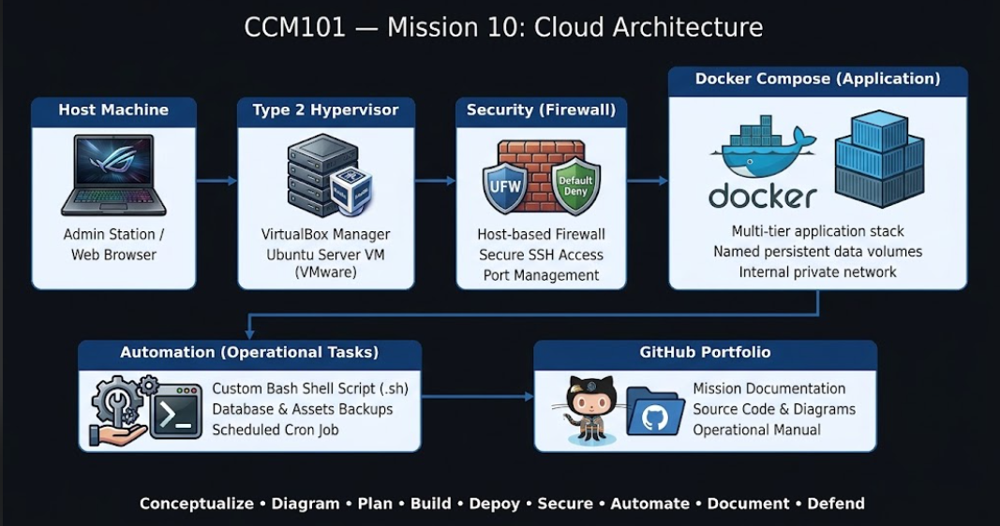

# Laboratory Activity 10: Mission 10 - The Enterprise Cloud Architect

## Mission Overview
As the final capstone project for the Cloud Computing course, this mission represents the culmination of my training from a Junior Trainee to an Enterprise Cloud Architect at CloudNova Technologies. This project involves the independent architecture, deployment, security hardening, disaster recovery automation, and executive documentation of a production-ready, multi-tier enterprise web application stack (WordPress & MySQL) deployed on Ubuntu Server.

## System Architecture Stack
- **Virtualization & OS:** Ubuntu Server running via Type-2 Hypervisor / Containerized Runtime.
- **Infrastructure as Code (IaC):** Docker & Docker Compose.
- **Application Tier:** WordPress (Latest) exposed on Port 80/8080.
- **Database Tier:** MySQL 8.0 with persistent volume binding for enterprise data durability.
- **Security:** UFW (Uncomplicated Firewall) with a Default-Deny posture.
- **Automation:** Custom Bash backup rotation script automated via Cron.

---

## System Architecture Diagram
*(This network topology diagram shows the host machine, Ubuntu Server VM, UFW firewall layer, isolated bridge network, and persistent storage volumes.)*

---

## Repository Contents
- [`docker-compose.yml`](./docker-compose.yml) – Multi-tier orchestration file with persistent volumes.
- [`automation-script.sh`](./automation-script.sh) – Automated MySQL backup and maintenance script.
- [`operational-manual.md`](./operational-manual.md) – End-to-end operational handoff guide for corporate IT teams.
- [`final-reflection.md`](./final-reflection.md) – Comprehensive personal synthesis of the entire cloud engineering journey.
